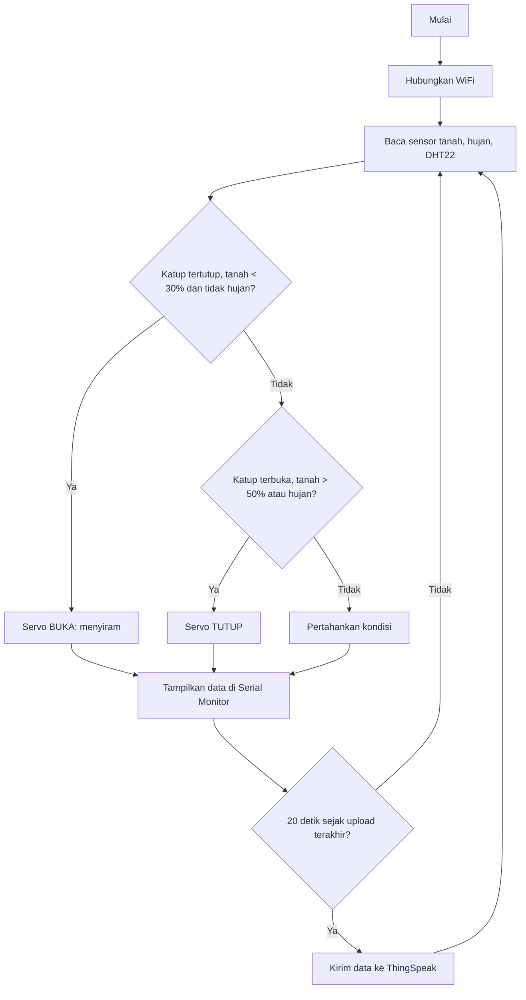

# Smart Plant Care berbasis ESP32

Sistem IoT penyiram tanaman otomatis menggunakan ESP32. Sistem membaca kelembaban tanah, kondisi hujan, serta suhu dan kelembaban udara, lalu menggerakkan servo (katup penyiram) secara otomatis dan mengirim data ke ThingSpeak lewat WiFi.

## 1. Deskripsi Singkat

Tanaman sering layu karena lupa disiram, atau justru tergenang saat hujan. Project ini menyiram tanaman hanya ketika tanah kering **dan** tidak sedang hujan, sehingga air lebih hemat.

## 2. Deskripsi Komponen

| Komponen | Fungsi |
|---|---|
| ESP32 | Mikrokontroler utama: membaca sensor, menjalankan logika, mengontrol servo, dan terhubung ke WiFi untuk mengirim data ke cloud |
| Sensor kelembapan tanah | Mengukur kadar air tanah (output analog), dikonversi menjadi persen |
| Sensor hujan | Mendeteksi adanya air/hujan pada permukaan sensor, dipakai untuk mencegah penyiraman saat hujan |
| DHT22 | Mengukur suhu dan kelembaban udara sebagai data pendukung monitoring |
| Servo | Aktuator yang membuka/menutup katup penyiram |

## 3. Skema Pin

| Komponen | Pin komponen | Pin ESP32 |
|---|---|---|
| Sensor tanah | AO | GPIO 34 |
| Sensor tanah | VCC | 3V3 |
| Sensor tanah | GND | GND |
| Sensor hujan | AO | GPIO 35 |
| Sensor hujan | VCC | 3V3 |
| Sensor hujan | GND | GND |
| DHT22 | DATA | GPIO 4 |
| DHT22 | VCC | 3V3 |
| DHT22 | GND | GND |
| Servo | Signal | GPIO 18 |
| Servo | VCC | VIN (5V) |
| Servo | GND | GND |

## 4. Alur Kerja Sistem

Penjelasan:
1. ESP32 terhubung ke WiFi dan otomatis mencoba menyambung ulang jika koneksi putus.
2. Setiap 2 detik, ESP32 membaca ketiga sensor.
3. Nilai sensor tanah dikonversi ke persen. Sensor hujan dibandingkan dengan ambang batas.
4. Logika kontrol (dengan histeresis agar servo tidak bolak-balik):
   - Servo **buka** jika tanah < 30% dan tidak hujan.
   - Servo **tutup** jika tanah > 50% atau hujan.
5. Data ditampilkan di Serial Monitor, lalu dikirim ke ThingSpeak setiap 20 detik.

## 5. Cara Menjalankan

1. Install library lewat Library Manager: **DHT sensor library**, **Adafruit Unified Sensor**, **ESP32Servo**.
2. Buat channel di [ThingSpeak](https://thingspeak.com) dengan 5 field: tanah, suhu, kelembapan udara, hujan, status servo. Salin *Write API Key*.
3. Buka `smart_plant_care.ino`, isi `WIFI_SSID`, `WIFI_PASS`, dan `THINGSPEAK_API_KEY`.
4. Pilih board **ESP32 Dev Module**, upload, lalu buka Serial Monitor (115200 baud).
5. Kalibrasi `SOIL_DRY` dan `SOIL_WET` sesuai nilai sensor kamu.
